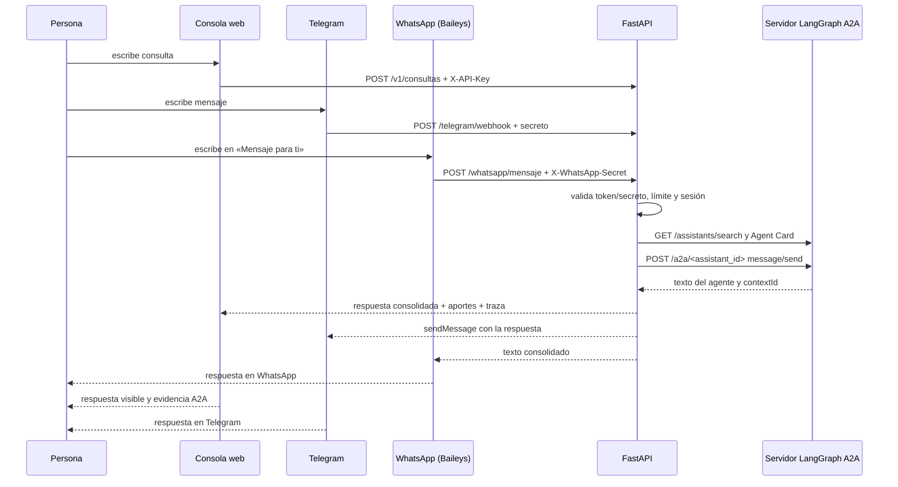

# Servicio FastAPI · Agentes A2A del Grupo 1

Implementación del **Taller de Implementación** del Certificado Agentic AI (UAI).
Reutiliza los cuatro agentes construidos en el Taller A2A y los expone con una API protegida, una
consola web de chat, un canal Telegram por webhook y un canal WhatsApp por medio de un puente
Baileys local.

## 1. Opción elegida

| Punto | Decisión |
| --- | --- |
| **Opción 1** | **Servicio FastAPI** con acceso protegido por token, límite de peticiones y trazas A2A. |
| **Opción 2** | **Canal web de chat** con frontend propio, **canal Telegram** por webhook y **canal WhatsApp** por puente Baileys; los tres comparten el mismo FastAPI y el mismo orquestador A2A. |
| **Problema que resuelve** | Una persona puede consultar desde el navegador o desde Telegram; el servicio elige uno o varios agentes A2A, conserva sus respuestas íntegras y devuelve una conclusión visible con evidencia de qué agente respondió. |
| **Qué se reutiliza** | Los cuatro agentes del Taller A2A: `agente_czz`, `agente_bryhan`, `agente_alejandra` y `agente_soluciones_comerciales_marketing`, con sus prompts, herramientas, grafos y servidores LangGraph. |
| **Qué es nuevo** | `servicio-fastapi/`: API, seguridad, orquestador, cliente A2A JSON-RPC, consola web, canal Telegram, pruebas y documentación. |
| **Qué no se hace** | No se construyen Gmail ni avatar. Tampoco se ejecutan pagos, compras o acciones externas. El canal WhatsApp usa un conector comunitario **no oficial** (Baileys), no la API oficial de Meta. |

## 2. Arquitectura

```text
Navegador ──► POST /v1/consultas + X-API-Key ──────────────────┐
Telegram  ──► POST /telegram/webhook + secreto ────────────────┤
WhatsApp  ──► Baileys (Node, loopback) ──► POST /whatsapp/mensaje + secreto ─┤
                                                               ▼
                              FastAPI (servicio-fastapi)
                                ├─ autenticación por token / secretos de canal
                                ├─ catálogo y selección de agentes
                                ├─ sesión: contextId A2A por agente (memoria)
                                ├─ cliente A2A JSON-RPC (sin a2a-sdk)
                                └─ consolidación fiel: texto íntegro de cada aporte
                                      │
                                      ├─► http://127.0.0.1:2025  agente_czz
                                      ├─► http://127.0.0.1:2026  agente_bryhan
                                      ├─► http://127.0.0.1:2027  agente_alejandra
                                      └─► http://127.0.0.1:2028  agente_soluciones_comerciales_marketing
```

El puente de WhatsApp escucha **solo en `127.0.0.1:18081`** y exige `WHATSAPP_SECRET`. La única
superficie pública del canal es el panel `/whatsapp` del propio FastAPI, protegido con `API_KEYS`.

> Baileys es un conector comunitario no oficial. Revisa los términos de WhatsApp y el riesgo de
> bloqueo antes de vincular una cuenta; usa un celular dedicado y un solo conector activo.



El servicio **no vuelve a redactar** las respuestas de los agentes. Si participan varios, las une bajo
encabezados con el texto íntegro de cada uno. Así se conservan cifras, unidades, condiciones y
supuestos. La consolidación es deliberadamente determinista.

La consola web y Telegram comparten el mismo orquestador A2A. En Telegram, cada chat mantiene su
propia sesión (`telegram-<chat_id>`) y puede elegir agentes con comandos, sin duplicar la lógica de los
agentes.

## 3. Requisitos y preparación manual

### Software

- Python **3.12** (probado con 3.12; el servicio acepta 3.11+).
- PowerShell 5.1 o superior en Windows (los comandos también se pueden adaptar a bash).
- Navegador moderno.
- Conexión a internet para los modelos de los agentes.

Las versiones exactas con las que se probó el servicio están en `requirements-lock.txt`
(generado con Python 3.12). `requirements.txt` mantiene rangos compatibles. No instales este lock en los
entornos de los agentes: cada uno tiene su propio `requirements.txt`.

### Cuentas y claves

| Componente | Clave | Dónde se configura |
| --- | --- | --- |
| Servicio FastAPI | `API_KEYS` (token de acceso al servicio) | `servicio-fastapi/.env` |
| `agente_czz` | `GOOGLE_API_KEY` | `mi-agente-cz/.env` |
| `agente_bryhan` | `GOOGLE_API_KEY` | `agente-bryhan/.env` |
| `agente_alejandra` | `GOOGLE_API_KEY` | `mi-agente-ale/.env` |
| `agente_soluciones_comerciales_marketing` | `GOOGLE_API_KEY` | `mi-agente-CM/.env` |
| Canal Telegram | `TELEGRAM_TOKEN` (BotFather) y `TELEGRAM_SECRET` | `servicio-fastapi/.env` |
| Canal WhatsApp | `WHATSAPP_SECRET` y Node 22+ | `servicio-fastapi/.env` y `package.json` |

- La clave `API_KEYS` es un **token de acceso al servicio**, no una clave de modelo. Se puede inventar
  una cadena larga; el servicio la compara en el servidor.
- Las claves de modelo viven solo en el `.env` de cada agente y **nunca** pasan por el navegador.
- Ningún `.env` se incluye en la entrega. Cada carpeta trae `.env.example`.
- Para Telegram se necesita un bot de BotFather y un túnel HTTPS; no se requieren cuentas de Gmail.
  El token y el secreto del webhook viven solo en el `.env` del servicio.
- Para WhatsApp se necesita **Node 22 o superior** y las dependencias del `package.json` de la raíz.
  La vinculación se hace desde `/whatsapp` con el celular del operador; no se usan cuentas de Gmail
  ni la API oficial de Meta.

### Puertos

| Proceso | Puerto por defecto |
| --- | --- |
| Servicio FastAPI | `8000` |
| `agente_czz` | `2025` |
| `agente_bryhan` | `2026` |
| `agente_alejandra` | `2027` (puede usar 2025 si corre solo) |
| `agente_soluciones_comerciales_marketing` | `2028` (puede usar 2025 si corre solo) |
| Puente WhatsApp (solo loopback) | `18081` |

Los puertos son configurables. Si cambian, actualiza `A2A_SERVIDORES` en `servicio-fastapi/.env`.

## 4. Instalación y arranque

### 4.1 Servidores de agentes

Cada agente se instala en su propia carpeta y en su propio entorno. Repite el patrón:

```powershell
cd mi-agente-cz
py -3.12 -m venv .venv
.venv\Scripts\python.exe -m pip install -r requirements.txt
if (-not (Test-Path .env)) { copy .env.example .env }
# Edita .env y pega GOOGLE_API_KEY
.venv\Scripts\langgraph.exe dev --port 2025
```

Para los otros agentes, cada bloque se ejecuta desde la raíz del taller:

```powershell
# Terminal 2 · Bryhan
cd agente-bryhan
py -3.12 -m venv .venv
.venv\Scripts\python.exe -m pip install -r requirements.txt
if (-not (Test-Path .env)) { copy .env.example .env }
# Edita .env y pega GOOGLE_API_KEY
.venv\Scripts\langgraph.exe dev --port 2026

# Terminal 3 · Alejandra
cd mi-agente-ale
py -3.12 -m venv .venv
.venv\Scripts\python.exe -m pip install -r requirements.txt
if (-not (Test-Path .env)) { copy .env.example .env }
# Edita .env y pega GOOGLE_API_KEY
.venv\Scripts\langgraph.exe dev --port 2027

# Terminal 4 · Carlos Monroy
cd mi-agente-CM
py -3.12 -m venv .venv
.venv\Scripts\python.exe -m pip install -r requirements.txt
if (-not (Test-Path .env)) { copy .env.example .env }
# Edita .env y pega GOOGLE_API_KEY
.venv\Scripts\langgraph.exe dev --port 2028
```

Para una prueba mínima bastan **dos** agentes: `agente_czz` en 2025 y `agente_bryhan` en 2026.
Cada servidor queda activo hasta presionar `Ctrl+C`.

Comprobación rápida de que un agente está arriba:

```powershell
Invoke-RestMethod -Method Post -Uri "http://127.0.0.1:2025/assistants/search" `
  -ContentType "application/json" -Body '{"graph_id":"agente_czz"}'
```

### 4.2 Servicio FastAPI

```powershell
cd servicio-fastapi
.\scripts\iniciar.ps1
```

El script:

1. crea `.venv` si no existe;
2. instala `requirements.txt`;
3. crea `.env` desde `.env.example` con una clave aleatoria si no existe;
4. arranca `scripts/servidor.py`, que inicia uvicorn y, si `WHATSAPP_HABILITADO=true`, también el
   puente Node de WhatsApp en `127.0.0.1:18081`.

Sin WhatsApp habilitado, el supervisor se comporta igual que uvicorn: la API y la consola web no
cambian. Si el puente no puede arrancar, la web sigue disponible y el panel informa `503`.

La clave generada queda en `servicio-fastapi/.env`. Para verla:

```powershell
Select-String -Path .env -Pattern '^API_KEYS='
```

No la muestres en capturas ni la subas al repositorio.

Alternativa manual:

```powershell
cd servicio-fastapi
py -3.12 -m venv .venv
.venv\Scripts\python.exe -m pip install -r requirements.txt
if (-not (Test-Path .env)) { copy .env.example .env }
# Edita .env: cambia API_KEYS y ajusta A2A_SERVIDORES
.venv\Scripts\python.exe -m uvicorn app.main:crear_app --factory --host 127.0.0.1 --port 8000
```

> El arranque usa `--factory` porque la aplicación se construye con `crear_app()`. Si tu herramienta
> pide un objeto ASGI, ejecuta `uvicorn app.main:crear_app --factory ...`.

### 4.3 Consola web

Abre `http://127.0.0.1:8000`, pega la clave de `API_KEYS` y presiona **Conectar**.
La consola muestra:

- agentes disponibles y su especialidad;
- selección de uno o varios agentes;
- modos `auto`, `individual`, `paralelo` y `colaborativo`;
- respuesta final;
- panel de traza con solicitud, estados, tiempos, `contextId` y pasos A2A.

La documentación interactiva de la API está en `http://127.0.0.1:8000/docs`
(se puede desactivar con `DOCS_HABILITADOS=false`).

### 4.4 Detener

- En la terminal del servicio: `Ctrl+C`.
- Para detener por puerto:
  ```powershell
  .\scripts\detener.ps1 -Puerto 8000
  ```
  Usa `-Force` para no pedir confirmación.
- En cada agente: `Ctrl+C` en su terminal.

## 5. API

Todas las rutas `/v1/*` requieren una clave válida en `X-API-Key` o en `Authorization: Bearer <token>`.

| Método | Ruta | Descripción |
| --- | --- | --- |
| `GET` | `/salud` | Estado público del servicio. |
| `GET` | `/v1/agentes` | Agentes A2A descubiertos y errores de descubrimiento. |
| `POST` | `/v1/consultas` | Consulta uno o varios agentes y devuelve la consolidación. |
| `DELETE` | `/v1/sesiones/{session_id}` | Cierra la memoria A2A de una sesión. |
| `POST` | `/telegram/webhook` | Webhook de Telegram; verifica el secreto y consulta el gateway A2A. |
| `POST` | `/whatsapp/mensaje` | Entrada interna del puente Baileys; exige `X-WhatsApp-Secret`. |
| `GET` | `/whatsapp` | Panel del operador para vincular y consultar el estado del canal. |
| `GET` | `/whatsapp/estado`, `/whatsapp/codigo`, `/whatsapp/qr` | Estado y datos de vinculación (requieren `API_KEYS`). |
| `POST` | `/whatsapp/conectar`, `/whatsapp/desconectar`, `/whatsapp/modo`, `/whatsapp/codigo` | Acciones de vinculación (requieren `API_KEYS`). |
| `GET` | `/` | Consola web. |
| `GET` | `/docs` | OpenAPI interactivo (si está habilitado). |

### 5.1 Consulta

```powershell
$base = "http://127.0.0.1:8000"
$clave = (Select-String -Path .env -Pattern '^API_KEYS=').Line.Split('=')[1]

$cuerpo = @{
  mensaje    = "¿Cuánto vale AAPL en el mercado US y qué debería revisar antes de invertir?"
  agentes    = @("agente_czz")
  modo       = "individual"
  session_id = "demo-12345678"
} | ConvertTo-Json

Invoke-RestMethod -Uri "$base/v1/consultas" -Method Post `
  -Headers @{ "X-API-Key" = $clave } `
  -ContentType "application/json; charset=utf-8" `
  -Body ([System.Text.Encoding]::UTF8.GetBytes($cuerpo))
```

> En PowerShell 5.1 conviene enviar el cuerpo como bytes UTF-8 (`UTF8.GetBytes`). Si se pasa el string
> directo, los acentos pueden viajar en otra codificación y el servidor responde `400` al no poder
> interpretar el JSON. El script `scripts/probar_api.py` ya lo hace correctamente.

Respuesta (resumida):

```json
{
  "solicitud_id": "…",
  "session_id": "demo-12345678",
  "modo": "individual",
  "agentes_consultados": ["agente_czz"],
  "respuesta": "texto exacto del agente",
  "aportes": [
    {
      "agente": "agente_czz",
      "autor": "Carlos Zapata",
      "estado": "ok",
      "respuesta": "texto exacto del agente",
      "duracion_ms": 1234,
      "context_id": "3f2a1c9d…",
      "contexto_reutilizado": false
    }
  ],
  "estado": "ok",
  "errores": [],
  "traza": [],
  "posible_falta_de_datos": false
}
```

- `respuesta`: si hay un agente, es su texto exacto; si hay varios, incluye encabezados y el texto
  íntegro de cada aporte.
- `aportes`: detalle por agente. `context_id` se muestra como prefijo; el valor completo se conserva
  solo en la sesión del servidor.
- `traza`: descubrimiento, selección y llamadas A2A con duración.
- `posible_falta_de_datos`: heurística que avisa si el agente pidió un dato; la pregunta del agente
  sigue siendo la respuesta autoritativa.

### 5.2 Modos

| Modo | Comportamiento |
| --- | --- |
| `auto` | El catálogo elige el mejor especialista por palabras clave y especialidad. |
| `individual` | Un agente; si no se indica, se elige el mejor. |
| `paralelo` | Se consultan a la vez los agentes indicados o los que coinciden con la consulta. |
| `colaborativo` | En orden, cada agente recibe los aportes anteriores como datos y responde desde su especialidad. La respuesta final contiene todos los aportes íntegros. |

- `agentes` es opcional. Si se indica, se valida que exista y esté disponible.
- `MAX_AGENTES_POR_CONSULTA` limita el abanico (4 por defecto).
- Si faltan datos, el agente los pide y el servicio devuelve esa pregunta tal cual. No inventa una
  conclusión.

### 5.3 Prueba automatizada del recorrido HTTP

Con el servicio arriba:

```powershell
.venv\Scripts\python.exe scripts\probar_api.py --url http://127.0.0.1:8000
```

El script prueba salud, acceso permitido, acceso rechazado, consulta real, entrada inválida y consola
web. Guarda un acta en `evidencias/ultima-prueba.json` sin incluir la clave. Para una consulta
multiagente:

```powershell
.venv\Scripts\python.exe scripts\probar_api.py `
  --agentes agente_czz,agente_alejandra `
  --modo paralelo `
  --consulta "Revisa Falabella: dato de mercado y cumplimiento normativo."
```

### 5.4 Canal Telegram

El webhook de Telegram usa **el mismo orquestador A2A** que la consola web. No hay agentes duplicados
ni lógica distinta: Telegram solo es otro punto de entrada.

Configura en `servicio-fastapi/.env`:

```env
TELEGRAM_TOKEN=token_de_botfather
TELEGRAM_SECRET=un_secreto_largo
TELEGRAM_API_BASE=https://api.telegram.org
```

1. Crea el bot con **@BotFather** y copia el token.
2. Levanta los agentes A2A y el gateway.
3. Publica el puerto 8000 con HTTPS (por ejemplo, `cloudflared tunnel --url http://localhost:8000`).
4. Registra el webhook:

```powershell
.venv\Scripts\python.exe scripts\set_webhook.py --url "https://tu-url.trycloudflare.com"
```

El script agrega `/telegram/webhook` y envía `secret_token`. Telegram enviará el header
`X-Telegram-Bot-Api-Secret-Token` en cada update; el gateway lo compara con `TELEGRAM_SECRET`.

Comandos de Telegram:

- Mensaje normal: el catálogo elige el agente (`auto`).
- `/agente_czz <consulta>`: consulta ese agente.
- `/agente <nombre> <consulta>`: consulta el agente indicado.
- `/paralelo agente_czz,agente_bryhan <consulta>`: consulta ambos a la vez.
- `/colaborativo agente_czz,agente_alejandra <consulta>`: aportes en cadena.
- `/start` o `/ayuda`: muestra la ayuda.

Cada chat conserva su sesión `telegram-<chat_id>` para la memoria A2A. Si `TELEGRAM_TOKEN` está vacío,
el webhook responde `503` con un mensaje claro; no simula una respuesta exitosa. La respuesta se envía
después de consultar a los agentes y se trunca a 4000 caracteres si excede el límite de Telegram.

### 5.5 Canal WhatsApp

El canal WhatsApp usa el **mismo orquestador A2A** que la consola y Telegram. Un puente Node
(Baileys) se conecta a la cuenta del operador y reenvía solo los mensajes nuevos que esa cuenta se
envía a sí misma en el chat **«Mensaje para ti»**. No lee historial, contactos ni grupos.

```text
WhatsApp del operador ⇄ Baileys (Node, 127.0.0.1:18081)
                              │ POST /whatsapp/mensaje + X-WhatsApp-Secret
                              ▼
                        FastAPI + orquestador A2A
```

#### Requisitos y configuración

Node 22+ y las dependencias del `package.json` de la raíz:

```powershell
npm ci --ignore-scripts
```

En `servicio-fastapi/.env`:

```env
WHATSAPP_HABILITADO=true
WHATSAPP_SECRET=secreto_largo_generado_con_secrets
WHATSAPP_URL_INTERNA=http://127.0.0.1:18081
WHATSAPP_TIMEOUT=20
WHATSAPP_MAX_CARACTERES=3500
```

Genera el secreto con:

```powershell
python -c "import secrets; print(secrets.token_urlsafe(32))"
```

#### Vincular la cuenta

1. Arranca el servicio (`scripts\iniciar.ps1` o `python scripts/servidor.py`).
2. Abre `http://127.0.0.1:8000/whatsapp` e introduce `API_KEYS` en **Clave del operador**.
3. Pulsa **Iniciar vinculación**. Cuando WhatsApp habilite la solicitud, **Obtener código** se activa.
4. Escribe tu número solo con código de país (7 a 15 dígitos, sin `+` ni espacios) y pulsa
   **Obtener código**. El código se muestra una sola vez y vence en 120 segundos.
5. En el celular: **WhatsApp → Dispositivos vinculados → Vincular un dispositivo → Vincular con
   número de teléfono** e ingresa el código.
6. Espera **Conectado** y envía un mensaje nuevo en **Mensaje para ti**.

También puedes usar **Usar QR** antes de pedir código. No se cambia de modo automáticamente y no se
solicita un segundo código tras un resultado incierto: revisa «Dispositivos vinculados», pulsa
**Desconectar** y luego **Iniciar nuevo intento**.

#### Comandos

Los mismos de Telegram: `/ayuda`, `/agente_czz <consulta>`, `/agente <nombre> <consulta>`,
`/paralelo agente_czz,agente_bryhan <consulta>` y `/colaborativo ...`.

Cada celular conserva una sesión `wa_<hash>` derivada de su identidad; la conversación mantiene su
`contextId` por agente. Las respuestas se recortan a `WHATSAPP_MAX_CARACTERES` (3500 por defecto).

#### Límites

- Baileys es un conector **no oficial**: puede infringir los términos de WhatsApp y exponer la cuenta
  a bloqueos. Úsalo con un celular dedicado y bajo tu responsabilidad.
- Un celular, una aplicación, un conector. No ejecutes dos copias con la misma cuenta.
- En Heroku el disco es efímero: cada deploy o reinicio puede exigir nueva vinculación. Las
  credenciales viven en `servicio-fastapi/whatsapp/.runtime/whatsapp-auth` (ignorado por Git).
- La deduplicación de mensajes vive en RAM (2048 identificadores) y se pierde al reiniciar.
- Solo se procesan mensajes de texto enviados por la propia cuenta a sí misma.

## 6. Seguridad

El detalle está en [`SEGURIDAD.md`](SEGURIDAD.md). Resumen:

- Token obligatorio en el servidor, comparado con `secrets.compare_digest`; acepta `X-API-Key` o
  `Authorization: Bearer`.
- Límite de peticiones por token e IP (`RATE_LIMIT_POR_MINUTO`, 30 por defecto).
- Claves de modelo solo en los `.env` de los agentes; la consola nunca las recibe.
- `.env.example` con valores ficticios; `.env` ignorado por git.
- Sin registro del texto de las consultas: la auditoría guarda hashes, agentes, estados, duraciones y
  prefijos de `contextId`.
- Cabeceras de seguridad y CSP estricta en la consola.
- Sin CORS abierto por defecto; si se habilita, se limita a `CORS_ORIGINS`.
- Las URLs de agentes solo salen de `A2A_SERVIDORES`; el usuario no puede inyectar URLs.
- Webhook Telegram protegido con `TELEGRAM_SECRET` en comparación de tiempo constante; el token solo
  vive en `.env`. Si falta, el webhook responde `503`; nunca simula éxito.
- Canal WhatsApp: el puente escucha solo en `127.0.0.1:18081` y exige `WHATSAPP_SECRET`; el panel y
  sus acciones exigen `API_KEYS`. No se registran códigos, números ni cuerpos de mensajes, y el
  código de vinculación vive solo en RAM.
- Errores claros: `401` acceso rechazado, `422` entrada inválida, `429` límite, `502` fallo de agentes,
  `503` sin agentes o Telegram no configurado, `504` timeout.

## 7. Pruebas

```powershell
cd servicio-fastapi
.venv\Scripts\python.exe -m pytest -q
```

Ejecuta la suite desde `servicio-fastapi`, no desde la raíz: cada carpeta de agente tiene su propia
suite y su propio entorno.

La suite cubre autenticación, token inválido, rate limit, validación, selección, consolidación fiel,
modos paralelo/colaborativo, sesión/memoria, errores de agente, timeout, frontend, cliente A2A JSON-RPC,
webhook de Telegram (secreto, ayuda, auto, agente explícito y paralelo) y canal WhatsApp (secreto,
ayuda, comandos, recorte y proxy del panel).
Resultado de esta entrega: **64 pruebas aprobadas y 1 prueba de integración omitida** (la integración
requiere servidores y claves reales).

El puente Node tiene su propia suite, sin red ni credenciales:

```powershell
cd ..
npm ci --ignore-scripts
npm run whatsapp:test
```

Resultado: **8 pruebas aprobadas** (secreto del puente, ciclo de vida, modos, teléfono y guard de
mensajes propios).

Prueba de integración real (con agentes arriba y `API_KEYS` configurada):

```powershell
$env:A2A_INTEGRATION = "1"
.venv\Scripts\python.exe -m pytest -m integracion -q
```

Diagnóstico de descubrimiento (no requiere clave del servicio):

```powershell
.venv\Scripts\python.exe -m app.diagnostico
```

## 8. Evidencias

La guía de capturas y el acta están en [`evidencias/README.md`](evidencias/README.md).
Casos mínimos:

1. Acceso autorizado: `GET /v1/agentes` y consulta real.
2. Acceso rechazado: misma ruta sin clave o con clave incorrecta.
3. Consulta de un agente con cifra/unidad visible.
4. Consulta multiagente con aportes A2A y conservación de cifras.
5. Dato faltante: el agente pide el país o ticker antes de concluir.
6. Fallo controlado: agente caído o entrada inválida con mensaje claro.
7. Canal Telegram: mensaje enviado al bot, respuesta consolidada recibida y log del webhook.

Captura automática opcional (con el servicio y los agentes arriba):

```powershell
.venv\Scripts\python.exe -m pip install -r requirements-evidencias.txt
.venv\Scripts\python.exe scripts\capturar_evidencias.py --url http://127.0.0.1:8000 --canal msedge
```

Genera `evidencias/capturas/` con las pantallas de acceso, consulta individual, multiagente, dato
faltante, traza A2A y un acta JSON/Markdown. Si Edge no está disponible, usa `--canal chromium` y
`python -m playwright install chromium`. Revisa y oculta datos sensibles antes de entregar.

Las capturas deben indicar **LOCAL**, fecha, solicitud, resultado esperado, resultado obtenido y
observaciones. No incluyas claves, tokens, `.env` ni datos privados.

## 9. Preparación para despliegue

El servicio está listo para ejecutarse en un contenedor o en un Procfile:

```powershell
docker build -t agentes-a2a-grupo1 .
docker run --rm -p 8000:8000 --env-file .env `
  --add-host=host.docker.internal:host-gateway `
  -e A2A_SERVIDORES="http://host.docker.internal:2025,http://host.docker.internal:2026" `
  agentes-a2a-grupo1
```

Despliegue en Heroku desde la raíz del monorepo:

```powershell
heroku login
heroku create a2a-grupo1-gateway
heroku git:remote -a a2a-grupo1-gateway
heroku config:set API_KEYS=... A2A_SERVIDORES=https://agente-czz.example.com,https://agente-bryhan.example.com TELEGRAM_TOKEN=... TELEGRAM_SECRET=... DOCS_HABILITADOS=false
git subtree push --prefix servicio-fastapi heroku main
heroku open
```

- `Procfile` y `.python-version` (3.12) ya están en `servicio-fastapi/`.
- `A2A_SERVIDORES` debe contener URLs públicas alcanzables desde Heroku; `127.0.0.1` no sirve en la
  nube. Los túneles rápidos de Cloudflare cambian de URL al reiniciar, así que hay que actualizar
  la variable cuando se reabren.

- `PORT` es configurable (`Dockerfile` y `Procfile` lo respetan).
- `API_KEYS`, `A2A_SERVIDORES`, `DOCS_HABILITADOS`, `CORS_ORIGINS` y los límites salen del entorno.
- Los agentes deben ser alcanzables desde el contenedor o desde la plataforma. En local,
  `host.docker.internal` apunta al equipo anfitrión.
- **No publiques los servidores `langgraph dev` sin autenticación.** El token protege al gateway, no
  a los agentes. Para un despliegue real, colócalos en una red privada o detrás de un proxy con
  autenticación.
- **Datos que se conservan:** no hay base de datos. Las sesiones y los `contextId` viven en memoria y
  se pierden al reiniciar. Si necesitas trazabilidad, conserva `logs/auditoria.jsonl`: contiene hashes,
  agentes, estados y duraciones, no el texto de las consultas.
- **Servicios externos:** Gemini (los cuatro agentes) y los servidores LangGraph.
  Sin ellos no hay respuesta de agente; el gateway devuelve un error claro.
- No se declara el +1 de despliegue: la entrega es local y reproducible. El `Dockerfile` y el
  `Procfile` dejan preparado el camino.

## 10. Límites conocidos

- Sesiones y rate limit viven en memoria: con varios workers no se comparten. Usa un worker o un
  almacén externo si se escala.
- La clave es compartida; no hay usuarios, roles ni auditoría individual por persona.
- El enrutador es determinista (palabras clave + catálogo). Si la consulta es ambigua, selecciona un
  agente; el usuario puede indicar varios o elegir manualmente.
- El servicio no valida aritmética ni veracidad: conserva el texto del agente. La verificación de
  cifras es responsabilidad del agente y de la persona.
- `posible_falta_de_datos` es una heurística; la pregunta del agente es la fuente de verdad.
- Los agentes LangGraph no tienen autenticación propia en `dev`; el gateway y la red local son la
  frontera de seguridad.
- Tras reiniciar un servidor de agentes cambian sus `assistant_id` y se pierden los hilos en memoria.
  Espera el refresco de catálogo (30 s) o inicia una conversación nueva.
- La consola guarda la clave en `sessionStorage`: es cómoda para la demo local, pero cualquier script del
  mismo origen podría leerla. La CSP y la ausencia de scripts de terceros reducen ese riesgo.
- HTTP local sin TLS. Para acceso remoto, usa un proxy con HTTPS.

## 11. Solución de problemas

| Síntoma | Causa probable | Acción |
| --- | --- | --- |
| `401` en la consola | Clave ausente o distinta de `API_KEYS` | Copia la clave de `.env`; no la cambies a mitad de sesión. |
| `503 SIN_AGENTES_DISPONIBLES` | Ningún servidor LangGraph responde | Levanta un agente y revisa `A2A_SERVIDORES`; ejecuta `python -m app.diagnostico`. |
| `502 AGENTES_FALLARON` | El agente falló o no tiene clave de modelo | Revisa su terminal y su `.env`. |
| `504 AGENTES_TIEMPO_AGOTADO` | El agente tardó más que `A2A_TIMEOUT` | Aumenta `A2A_TIMEOUT` o revisa la cuota del modelo. |
| `429 LIMITE_ALCANZADO` | Más de `RATE_LIMIT_POR_MINUTO` | Espera o sube el límite. |
| La consola dice «sin agentes» | Servidores abajo o puertos distintos | Arranca los agentes, ajusta puertos y reconecta. |
| Telegram responde `403` | `TELEGRAM_SECRET` no coincide con el webhook | Vuelve a registrar el webhook con el mismo secreto. |
| Telegram responde `503` | Falta `TELEGRAM_TOKEN` o `TELEGRAM_SECRET` | Configura ambos en `servicio-fastapi/.env` y reinicia. |
| Telegram no contesta | Webhook no registrado, sin túnel HTTPS o token inválido | Revisa `set_webhook.py`, la URL pública y el token. |
| `langgraph` no se reconoce | Entorno del agente no activado | Usa `.venv\Scripts\langgraph.exe`. |
| El puerto está ocupado | Otro proceso | Cambia `--port` y `A2A_SERVIDORES`; usa `detener.ps1`. |

## 12. Estructura

```text
servicio-fastapi/
├── app/
│   ├── main.py            # FastAPI, rutas, middleware, manejo de errores
│   ├── config.py          # Settings desde .env
│   ├── seguridad.py       # token y rate limit
│   ├── a2a.py             # cliente JSON-RPC y descubrimiento
│   ├── catalogo.py        # catálogo del Grupo 1 y selección
│   ├── orquestador.py     # modos, sesiones, consolidación y auditoría
│   ├── sesiones.py        # contextId por sesión
│   ├── auditoria.py       # JSONL sin secretos
│   ├── telegram.py        # webhook Telegram → orquestador A2A
│   ├── diagnostico.py     # CLI de descubrimiento
│   └── static/            # consola web (HTML/CSS/JS)
├── tests/                 # unitarias y de integración
├── scripts/               # iniciar, detener, probar_api, set_webhook
├── evidencias/            # guía y actas de prueba
├── .env.example
├── .python-version
├── requirements.txt
├── requirements-lock.txt
├── requirements-evidencias.txt
├── pyproject.toml
├── Dockerfile
├── Procfile
└── docker-compose.yml
```
